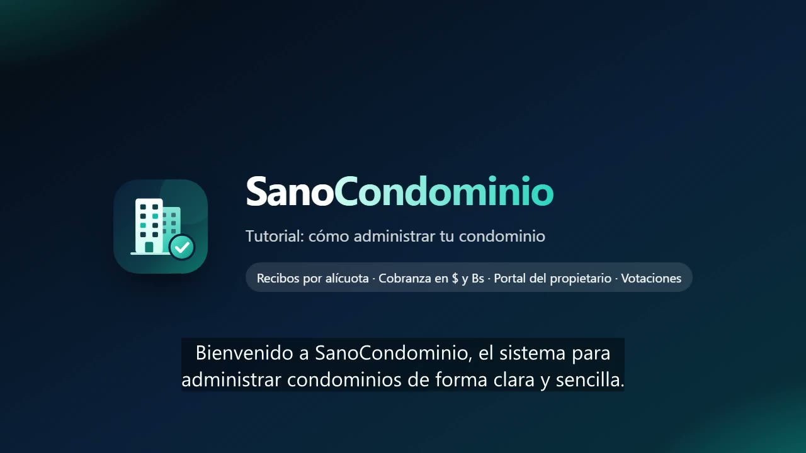

# SanoCondominio 🏢

Software de administración de condominios para juntas de condominio y administradoras, de la línea **Sano** (SanoGym, SanoDental, SanoDoctor, SanoTecnico, SanoGestion, SanoCortes, SanoFarmacia, SanoLicores).

**Producción:** https://sano-condominio.web.app · **Credenciales:** `CREDENCIALES_SANO_CONDOMINIO.txt` (no se sube a git)



## Qué hace

| Módulo | Detalle |
|---|---|
| Tu mes en 3 pasos | El inicio guía cada edificio: cargar gastos → emitir recibos → cobrar. Avisos de pagos reportados, solicitudes y reservas por aprobar. |
| Edificios y unidades | Varios edificios por administración. Asistente que crea las unidades por pisos (1-A, 101, casas…), alícuotas que suman 100 %, propietario, inquilino, saldo inicial. Importar/exportar CSV. |
| Gastos del mes | Categorías con un toque (vigilancia, conserjería, agua, ascensores…), comunes o no comunes, proveedores, pagados desde el fondo, copiar los fijos del mes anterior y **cuotas especiales** por alícuota o monto fijo. |
| Recibos | Gastos comunes + honorarios + fondo de reserva repartidos por alícuota, más no comunes, cuotas especiales y **mora** solo sobre lo vencido. Vista previa, emisión en un clic, impresión y envío por WhatsApp; anulación si te equivocas. Reparto al céntimo exacto. |
| Cobranza | Pagos en dólares o bolívares a **tasa BCV** del día, abonos parciales, saldo a favor, aplicación a los recibos más viejos, pagos reportados desde el portal para confirmar, morosos y recordatorios por WhatsApp. |
| Portal del propietario | `/portal/CÓDIGO` sin contraseña: saldo, recibos, dónde pagar, reportar pago, comunicados, votar, relación de gastos, solicitudes y reservas. |
| Comunidad | Comunicados con plantillas, solicitudes y reclamos por estado, reservas de áreas comunes sin choques y con cobro a la unidad, **votaciones ponderadas por alícuota** con quórum y acta. |
| Fondos | Fondo de reserva que crece con cada emisión, fondos especiales, aportes/retiros con PIN y libro de ingresos y egresos. |
| Reportes | Cobranza por mes, morosidad por antigüedad, gastos por categoría, pagos con CSV, constancias de solvencia y estados de cuenta. |
| Demo | 30 minutos sin registro con una administradora de ejemplo (2 edificios, 36 unidades, PIN 1234) y recorrido guiado; todo se borra al terminar. |

## Estructura

- `public/` — la app (JavaScript sin compilación + Firebase 10.14.1). `js/views/` una pantalla por archivo; `js/condo.js` cálculo de recibos, estado de cuenta y morosidad; `js/ops.js` operaciones (emitir, cobrar, anular, publicar portales).
- `firestore.rules` — cada administración solo ve lo suyo (`tenants/{uid}`); `portals/{código}` se lee solo por código exacto; `inbox` valida cada pago, solicitud, reserva o voto que llega desde un portal.
- `scripts/` — aprovisionamiento, pruebas y video tutorial.

## Comandos (desde `scripts/`)

```sh
# Emuladores (en la carpeta del proyecto)
firebase emulators:start --only auth,firestore,hosting --project sano-condominio   # app en http://127.0.0.1:5171/?emu=1

sh test-emu.sh                 # crea las cuentas en el emulador y corre la prueba E2E (45 verificaciones)
node mobile-check.mjs          # 6 tamaños de pantalla (320 px a portátil) + portal, sin desbordes
node prod-smoke.mjs            # prueba rápida en producción (la demo se limpia sola)
node pwa-check.mjs             # instalable en PC y Android

node provision.mjs 20          # crea/actualiza las cuentas en producción
node icons.mjs                 # regenera íconos y logos desde public/assets/logo.svg
node tutorial/make-video.mjs   # graba el video tutorial narrado (voz es-VE)
firebase deploy --only firestore,hosting --project sano-condominio
```
